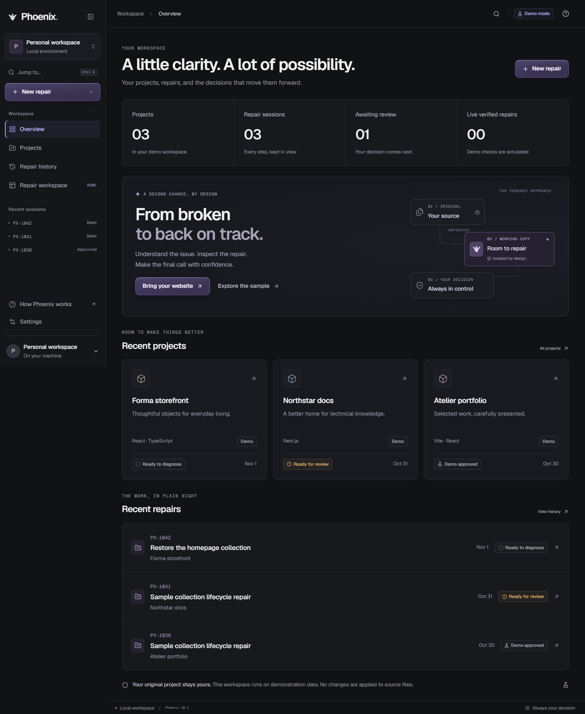
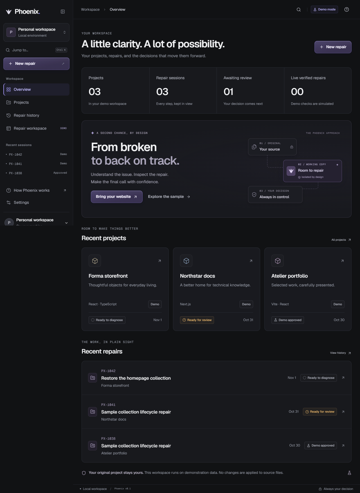
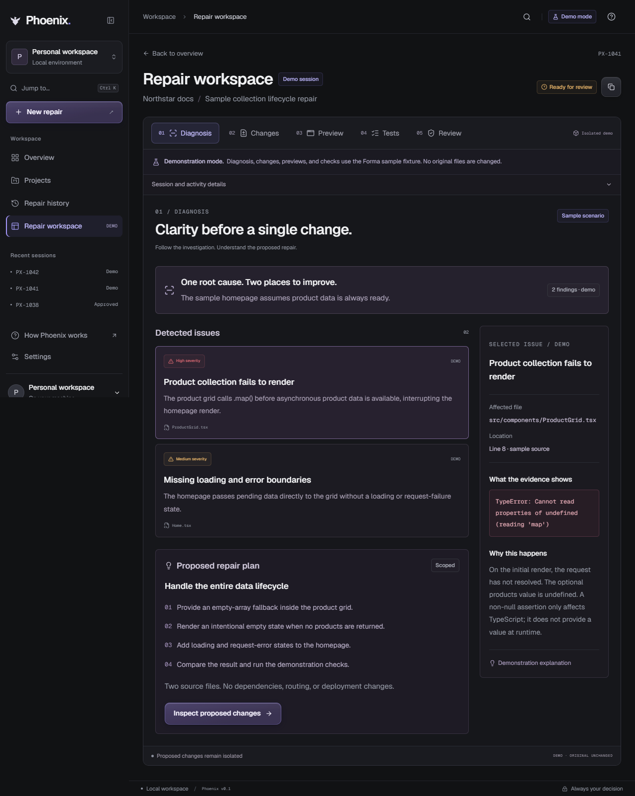
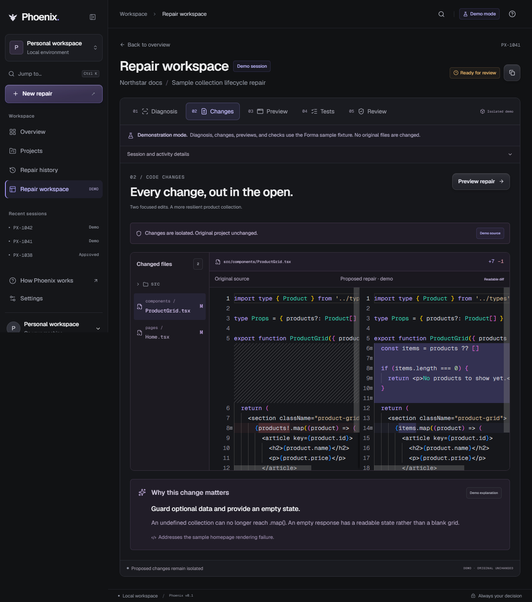
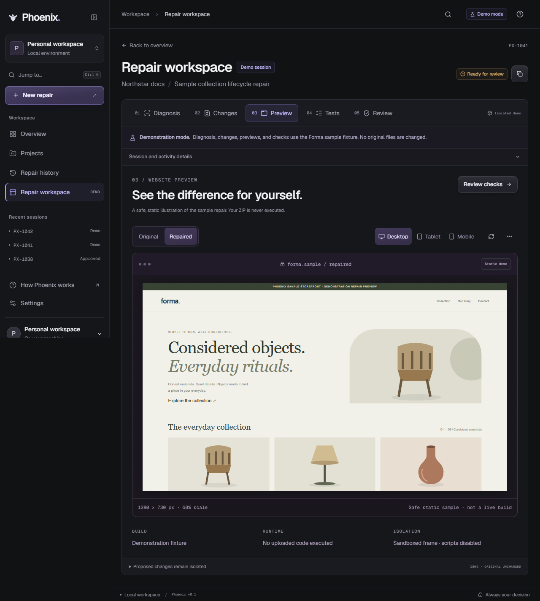

# 🔥 Phoenix — AI-Assisted Website Repair Workspace

> **Diagnose. Repair. Verify. Review.** A developer-focused workspace for exploring a transparent, human-controlled website repair workflow.



## Overview

**Phoenix** is a prototype website-repair platform combining a polished React dashboard, a standalone Node.js backend, and an experimental Python AI repair agent. Its goal is to make website fixes easier to inspect: identify issues, compare proposed code changes, preview outcomes, review verification evidence, and make an explicit approval decision.

**Current status:** The frontend provides a complete **labeled demo workflow**. The backend has real project-import storage and a **bundled deterministic demo repair**, but general imported-project repair is not yet connected end to end. The Python agent is a separate experimental command-line tool. Do not confuse demo checks with real website verification.

## Features

- **Project dashboard:** browse projects, sessions, and repair history.
- **Import experience:** sample project and ZIP-selection demo in the frontend; backend API supports validated project-file import.
- **Diagnosis workflow:** inspect issues, evidence, and suggested repair plans in demo mode.
- **Code comparison:** Monaco-powered desktop diff and readable mobile diff.
- **Before/after preview:** responsive, script-restricted sample website preview.
- **Verification review:** explicit demo test results, including failure scenarios.
- **Human approval:** review changes before approving or rejecting; frontend decisions do **not** apply source changes.
- **Backend lifecycle:** local SQLite persistence, audit events, version snapshots, and demo-specific approval/rollback endpoints.
- **Experimental AI agent:** create an OpenAI-assisted repair proposal in a copied workspace without editing the original project.

## Technology Stack

| Layer | Technologies |
| --- | --- |
| Frontend | React 19, TypeScript, Vite 8, React Router |
| Styling & UI | Tailwind CSS 4, Radix UI, Lucide, Motion, Geist fonts |
| Code diff | Monaco Editor |
| Client state | Zustand |
| Backend | Node.js 22.12+, Express 5, built-in SQLite |
| Experimental agent | Python 3.10+, OpenAI Agents SDK, Pydantic |
| Testing | Playwright (frontend), Node.js test runner (backend) |

## Getting Started

### Prerequisites

- **Node.js 22.12 or later** and npm
- Git
- **Optional:** Python 3.10+ for the experimental repair agent
- **Optional:** Docker Desktop for backend sandbox-execution experiments (Docker availability does not mean arbitrary imported projects are supported)

### 1. Clone the repository

```bash
git clone https://github.com/ansh01rawat/Phoenix.git
cd Phoenix
```

### 2. Run the frontend

```bash
npm ci
npm run dev
```

Open **http://127.0.0.1:5173/app**.

The frontend uses **local demo services** and can be explored without starting the backend or providing an API key.

### 3. Run the backend (separate terminal, optional)

```bash
cd server
npm ci
npm run dev
```

Backend API: **http://localhost:3001** (default). Verify it using:

```bash
curl http://localhost:3001/api/health
```

**Important:** Starting both servers does **not** automatically connect the demo frontend to the backend. The frontend/backend integration is still pending.

### 4. Configure optional AI access

For backend AI provider features, set `OPENAI_API_KEY` and `OPENAI_MODEL` in the **backend process environment**. Do not place secrets in frontend source code or commit them to Git. Provider calls can incur costs and send selected project text to the configured model.

## Demo Walkthrough

1. Visit `/app` and select **New repair**.
2. Choose **Use sample project**, or select the included demo ZIP.
3. Run the **demo diagnosis** and inspect issue evidence.
4. Open **Changes** to compare the proposed edits.
5. Use **Preview** to compare original and repaired sample pages at different viewport sizes.
6. Run **demo checks**, including the optional failure scenario.
7. Open **Review** and explicitly approve or reject the simulated proposal.

The browser demo does not modify an imported project or deploy changes.

## Screenshots

| Dashboard | Diagnosis |
| --- | --- |
|  |  |

| Code changes | Preview |
| --- | --- |
|  |  |

## Project Structure

```text
Phoenix/
├── src/                  # React application, features, services and stores
├── server/               # Express API, SQLite state, demo repair and tests
├── tests/e2e/            # Playwright browser tests
├── docs/                 # Architecture, design, QA notes and screenshots
├── public/               # Icons and demo assets
├── repair_agent.py       # Separate experimental Python repair agent
├── requirements.txt      # Python dependencies
├── package.json          # Frontend scripts and dependencies
└── vite.config.ts        # Vite development configuration
```

## Development & Tests

From the repository root:

```bash
npm run build       # TypeScript check and production build
npm run lint        # Oxlint
npm run typecheck   # TypeScript checks
npm run test:e2e    # Playwright tests
npm run preview     # Preview the built frontend on port 4173
```

For Playwright's Chromium browser, install the browser if necessary:

```bash
npx playwright install chromium
```

From `server/`:

```bash
npm test
```

## Experimental Python Repair Agent

The separate Python CLI creates a baseline copy and an editable workspace, requests a structured proposal from an OpenAI model, and writes a patch for manual review. It **does not** run tests, preview, deploy, or modify the original input project.

**Windows PowerShell setup:**

```powershell
py -m venv .venv
.venv\Scripts\Activate.ps1
python -m pip install -r requirements.txt
$env:OPENAI_API_KEY = 'your-api-key'
$env:OPENAI_MODEL = 'your-approved-model'
python repair_agent.py "C:\path\to\your-website" "Describe the bug and expected behavior"
```

Generated files are stored under `.phoenix/runs/<run-id>/` and include `baseline/`, `workspace/`, `proposal.json`, and `diff.patch`. Review proposals before using any edits. This is **not** a hardened security sandbox.

## Backend API (Selected Endpoints)

| Endpoint | Purpose |
| --- | --- |
| `GET /api/health` | Service health |
| `GET /api/projects` | List imported projects |
| `POST /api/projects/import` | Import validated source files |
| `POST /api/sessions` | Start the bundled demo repair |
| `GET /api/sessions/:id` | Retrieve demo repair state |
| `GET /api/sessions/:id/patches` | Inspect demo patch |
| `GET /api/sessions/:id/verification` | Inspect demo verification |
| `POST /api/sessions/:id/approve` | Approve/apply bundled demo repair |
| `POST /api/sessions/:id/reject` | Reject demo repair |
| `POST /api/sessions/:id/rollback` | Roll back approved bundled demo repair |

These session endpoints are **demo-specific**, not a general-purpose imported-project repair API. See [backend architecture](docs/backend-architecture.md) and [backend setup](server/README.md).

## Security & Limitations

- The frontend's diagnosis, previews, verification, and decisions are **simulated**; frontend approval does not apply source edits.
- Backend demo approval can change the **bundled demo source**; imported projects do not yet support the full repair flow.
- The Python agent sends selected source text to an external model when configured; inspect project content and authorization before use.
- Sandbox and file-validation safeguards are experimental and should **not** be treated as complete protection against hostile projects.
- Do not upload credentials, secrets, or sensitive source without appropriate authorization.

## Roadmap

Potential next steps include connecting the frontend to the backend, implementing evidence-based diagnosis and repairs for imported projects, adding genuinely isolated preview/test execution, and expanding verification coverage. These are **planned improvements, not current capabilities**.

## Contributing

Contributions and issue reports are welcome. Fork the repository, create a feature branch, run the relevant checks, and submit a pull request describing your changes.

## Repository

**Source:** [ansh01rawat/Phoenix](https://github.com/ansh01rawat/Phoenix)

For more details, see [frontend documentation](docs/frontend.md), [backend documentation](server/README.md), and [design system](design.md).
